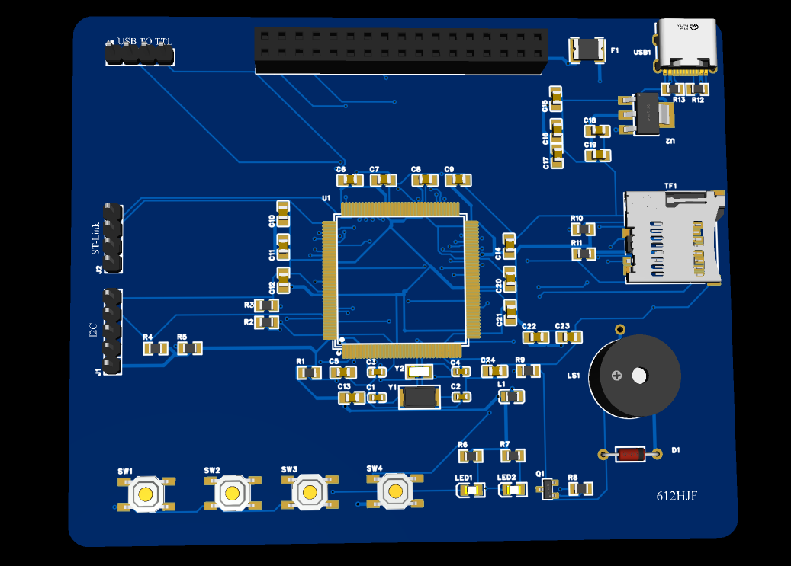

# 基于 STM32 的手持红外热成像仪

用 STM32F103ZET6 + MLX90640（32x24 红外点阵）做的一台手持热像仪：串行读帧、定点 Q8 双线性插值放大到 256x192、伪彩色热力图输出到 2.8 寸并口屏，支持高低温自动追踪、三套调色板、画面冻结与 SD 卡拍照、超温声光预警。

主板为自制双层板，原理图、PCB、Gerber、BOM、坐标文件与固件均已完成并实板验证。

## 硬件组成

| 部分 | 选型 |
|---|---|
| 主控 | STM32F103ZET6，LQFP-144，72 MHz，512 KB Flash |
| 红外传感器 | GY-MCU90640 模块（MLX90640，32x24，I2C 地址 0x33） |
| 显示 | ATK-MD0280 2.8 寸 320x240 TFT，16 位并口，2x17 排母直插 |
| 存储 | 板载 TF 卡座，SDIO + FAT32，拍照存 24bpp BMP |
| 时钟 | 8 MHz 主晶振（22 pF）、32.768 kHz RTC 晶振（10 pF） |
| 交互 | 4 个轻触按键、2 个 LED、5 V 有源蜂鸣器（SS8050 驱动） |
| 供电 | Type-C 16P（仅供电）5 V -> 0.5 A 自恢复保险丝 -> AMS1117-3.3，CC1/CC2 各 5.1k 下拉 |
| 保护/调试 | 1N4148、磁珠、自恢复保险丝，5P SWD，2 组 4P 扩展 IO |

板卡参数：100 x 80 mm，双层，板厚 1.6 mm，1 oz 铜厚，FR-4。58 个元件、334 个焊盘、93 个过孔、61 个网络，PCB DRC 0 错误 0 违规。

## 功能

| # | 功能 | 实现 |
|---|---|---|
| 1 | 红外温度实时采集 | 软件 I2C 读 MLX90640，坏点修正与温度解算 |
| 2 | 热力图插值放大 | 定点 Q8 双线性插值，32x24 -> 256x192 |
| 3 | 高低温自动追踪 | 帧内极值搜索 + EMA 平滑，双色十字准心 |
| 4 | 调色板切换 | 铁红 / 彩虹 / 黑白，KEY0 循环切换 |
| 5 | 冻结与拍照 | WK_UP 冻结并写 SD 卡 BMP，再按一次解冻 |
| 6 | 超温预警 | 50 摄氏度触发、48 摄氏度解除，施密特迟滞 |

按键：KEY0 切换调色板，KEY1 切换插值模式，WK_UP 冻结/拍照。

## 目录结构

```text
.
├─ 01_设计说明/         项目说明、打样与工艺说明、6 项功能验收记录及实测照片录像
├─ 02_原理图与PCB/      EDA 源工程、原理图 PDF、Gerber、BOM、坐标、2D/3D 预览、STEP 模型
├─ 03_固件工程/         Keil MDK5 完整工程，标准外设库，可直接编译
├─ 04_烧录文件/         已编译 hex，ST-Link 直接下载
└─ 05_开题答辩/         开题答辩 PPT，开题报告与任务书在根目录
```

## 编译与烧录

1. Keil MDK5 打开 `03_固件工程/USER/ThermalImager.uvprojx`，直接 Build（F7），无需改配置。优化等级 -O2，上次全量编译 Code=58058 B，0 error 0 warning。
2. 或直接用 `04_烧录文件/ThermalImager_v1.2.hex` 通过 ST-Link V2 下载。
3. SWD 四线接板上 J1：3.3V / SWDIO / SWCLK / GND。
4. 上电前确认 MLX90640 模块 PS 脚接地，否则模块停留在串口模式，I2C 读不到数据。

## 设计资料

- 原理图：[02_原理图与PCB/原理图.pdf](02_原理图与PCB/原理图.pdf)
- PCB 2D 预览：[02_原理图与PCB/PCB_2D预览.png](02_原理图与PCB/PCB_2D预览.png)
- 打样文件：`02_原理图与PCB/Gerber制板文件.zip`（嘉立创下单直接上传）
- 手焊物料清单：[02_原理图与PCB/手焊物料清单.xlsx](02_原理图与PCB/手焊物料清单.xlsx)
- 叠层、阻抗与工艺说明：[01_设计说明/打样与工艺说明.md](01_设计说明/打样与工艺说明.md)

## 外观



主控库无 3D 本体，图中芯片位置只显示焊盘。

## 已知限制

- 传感器走软件 I2C，单帧读取约 200 ms，整机有效帧率约 3.9 Hz。
- 整帧 16 位并口刷屏约 15 ms；手机拍摄时可能出现水平色带，是刷新率与相机帧率的时间混叠，肉眼不可见。
- Type-C 只供电，D+/D- 未连接，板上没有 USB 数据链路，不需要做 90 欧姆差分阻抗控制。
- 供电入口未加专用 ESD/TVS 器件，插拔保护依赖保险丝与板级布局。
- 主控库没有 3D 本体，3D 渲染图中该位置只显示焊盘。

## 版本

v1.4（2026-11-17）：按最新工程重新导出 Gerber/BOM/坐标，PCB DRC 0 违规；更新原理图 PDF，补充 2D 预览图与 3D 渲染图。